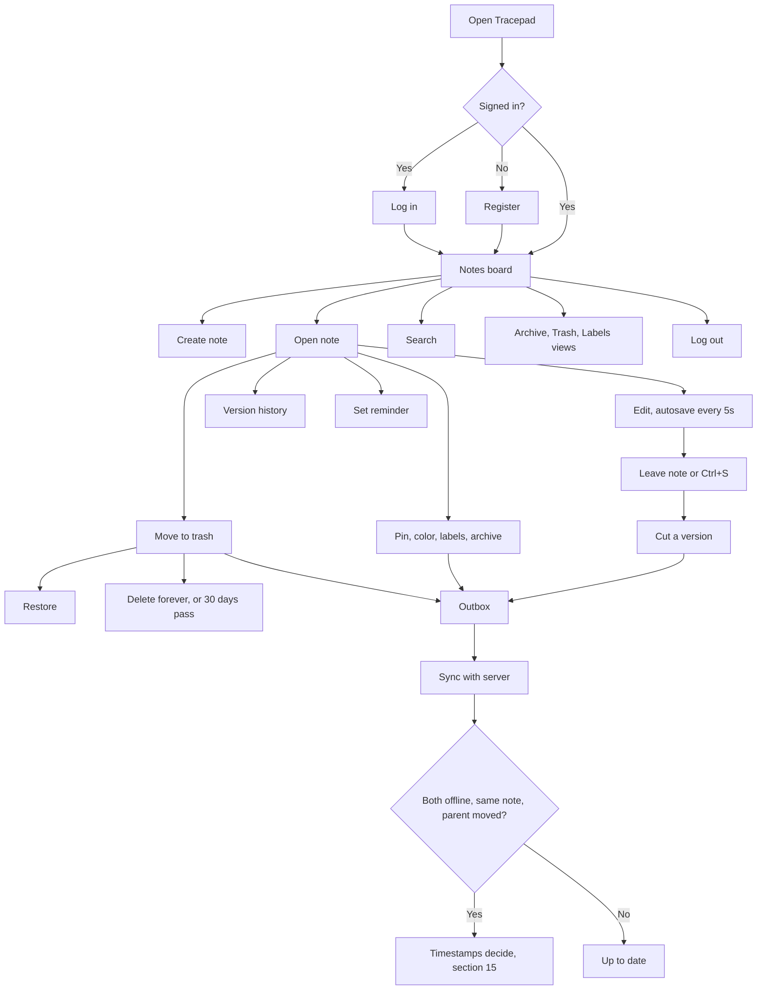
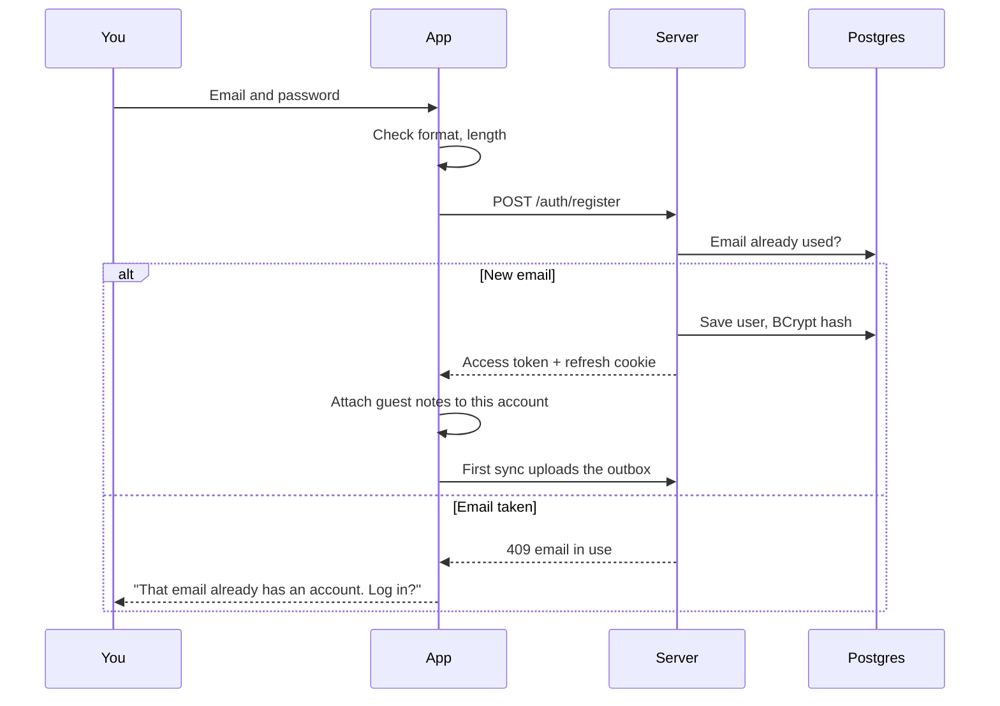
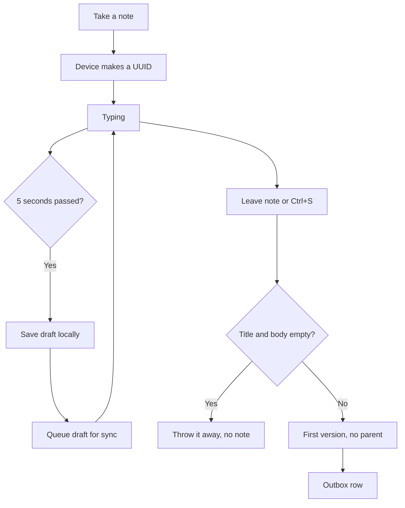
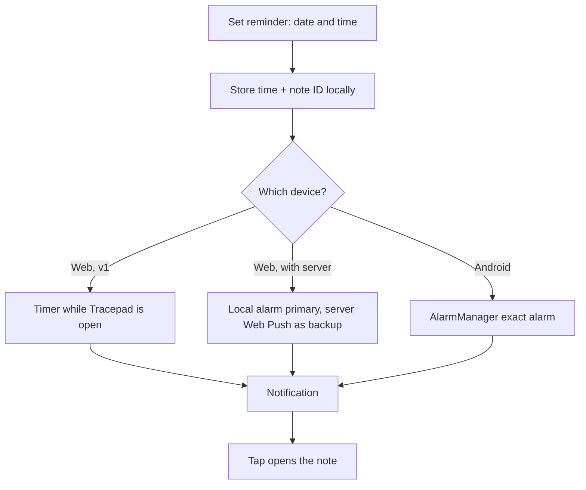
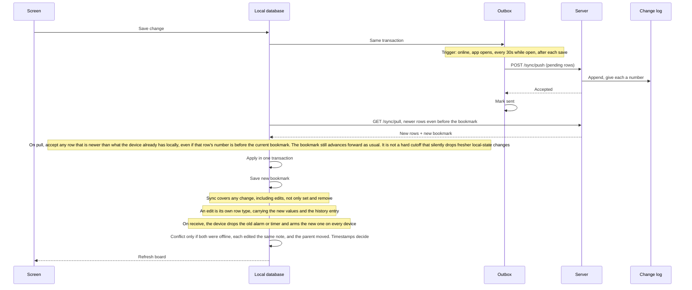
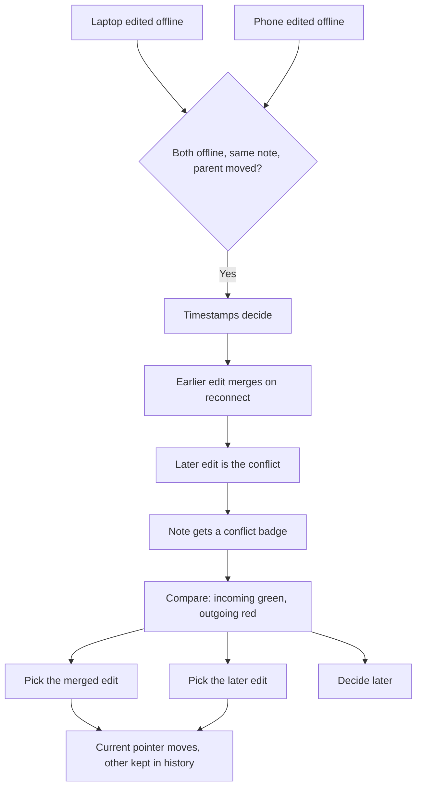
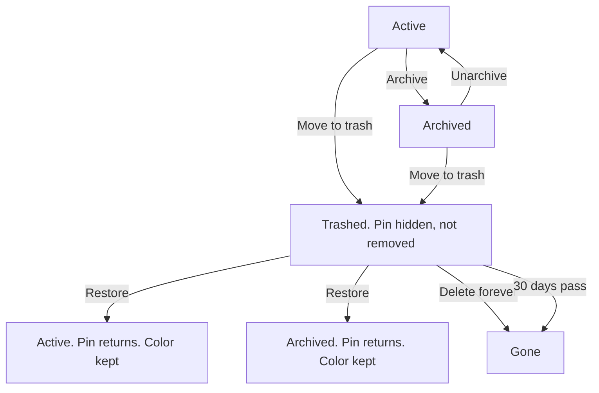

# Tracepad: the full flow

Everything a person can do in Tracepad, from opening the app for the first time to deleting a note forever, and what happens underneath each step. Each part names the technology that does the work. Sections 3 to 16 are version 1. Section 18 adds the version 2 flows from `learnings/notes.md`. Section 17 is the project's file structure, and sections 19 and 20 are the plans for both versions.

Nothing here is built yet. This is the plan to review before the build starts. Anything marked **Proposed** is a default that has not been agreed yet. The list at the end collects them in one place.

---

## 1. Tech stack

| Layer                  | Web (first)                                                                         | Server (second)                                                              | Android (third)                               |
| ---------------------- | ----------------------------------------------------------------------------------- | ---------------------------------------------------------------------------- | --------------------------------------------- |
| Language               | TypeScript                                                                          | Java 21                                                                      | Kotlin                                        |
| Framework              | React, built with Vite                                                              | Spring Boot                                                                  | Jetpack Compose                               |
| Screens and routing    | React Router                                                                        | —                                                                            | Compose Navigation                            |
| Local database         | IndexedDB through `idb` (v1), Dexie (v2)                                            | —                                                                            | Room (SQLite)                                 |
| Offline app shell      | Service worker via `vite-plugin-pwa` (Workbox)                                      | —                                                                            | Built in: the app is installed                |
| Server database        | —                                                                                   | PostgreSQL                                                                   | —                                             |
| Database migrations    | Upgrade step built into `idb`                                                       | Flyway                                                                       | Room migrations                               |
| Talking to the server  | `fetch`                                                                             | Spring Web (REST, JSON)                                                      | Retrofit + OkHttp, kotlinx.serialization      |
| Accounts               | Login screens                                                                       | Spring Security, BCrypt password hashing, JWT access tokens + refresh tokens | Login screens                                 |
| Storing the login      | Refresh token in an httpOnly cookie, access token in memory                         | —                                                                            | DataStore, encrypted with Android Keystore    |
| Background sync        | While open; Background Sync on Chromium                                             | —                                                                            | WorkManager                                   |
| Reminders              | Local alarm primary (tab timer), Web Push backup via service worker (after server)  | Web Push sender (`web-push` Java library, VAPID keys), scheduled job         | AlarmManager (exact alarms), boot receiver    |
| Email (password reset) | —                                                                                   | Spring Mail; Mailpit in Docker while local                                   | —                                             |
| Tests                  | Vitest, `fake-indexeddb`, React Testing Library, Playwright                         | JUnit 5, Spring Boot Test, Testcontainers (real Postgres)                    | JUnit, Room in-memory tests, Compose UI tests |
| Running locally        | `npm run dev`                                                                       | Docker Compose (server + Postgres + Mailpit)                                 | Android Studio emulator                       |

---

## 2. The whole journey at a glance



---

## 3. First open

**What you see:** Sign in.

**Proposed:** Tracepad works fully with an account. Notes are saved on the device, and the outbox fills up as you go. Signing out and back in later uploads everything. This keeps the app offline-first from the very first second.

| Possibility                      | What happens                                                                                | Tech                                |
| -------------------------------- | ------------------------------------------------------------------------------------------- | ----------------------------------- |
| First ever open, online          | The app shell downloads and is cached by the service worker. The local database is created. | Vite build, Workbox, `idb` upgrade  |
| First ever open, offline         | The web app can't load at all. Nothing is cached yet. Android has no problem.               | Browser limit                       |
| Later opens, offline             | The app shell loads from the cache, and notes load from IndexedDB.                          | Service worker cache                |
| Leftover draft from a crash      | It's turned into a version before the board shows. (See section 8.)                         | Startup step in the database module |
| A new app version is deployed    | The service worker downloads it in the background and shows "Update ready, reload".         | Workbox update prompt               |
| Local database is an older shape | An upgrade step runs once and moves the data.                                               | `idb` `upgrade()`, Room migration   |

---

## 4. Register



| Possibility                         | What happens                                                                        | Tech                                |
| ----------------------------------- | ----------------------------------------------------------------------------------- | ----------------------------------- |
| Valid email, password 8+ characters | The account is created, you're signed in, and guest notes upload.                   | Spring Security, BCrypt, JWT        |
| Bad email format                    | Shown on the form. Nothing is sent.                                                 | Form validation in React            |
| Password too short                  | Shown on the form. The server checks again.                                         | React + Bean Validation             |
| Email already registered            | Offers to log in instead.                                                           | 409 response                        |
| Offline                             | The button is disabled, with "Registering needs internet." Notes stay as a guest's. | `navigator.onLine` + failed request |
| Server down                         | "Can't reach Tracepad right now." Try again later. Nothing is lost.                 | `fetch` error handling              |
| Clicked twice                       | Only one account is created. Email is a unique column.                              | Unique index in Postgres            |

**Proposed:** no email verification in v1. It needs a real mail service to be useful. Add it when the server is hosted online.

---

## 5. Log in, log out, sessions

| Possibility                                         | What happens                                                                                       | Tech                                            |
| --------------------------------------------------- | -------------------------------------------------------------------------------------------------- | ----------------------------------------------- |
| Correct login, first time on this device            | A full download from the start: bookmark = 0. The device ID is created.                            | Pull endpoint, cursor                           |
| Correct login, guest notes on this device           | Guest notes join the account and upload. Nothing is replaced.                                      | Outbox upload                                   |
| Wrong password                                      | "Email or password is wrong." It doesn't say which one.                                            | Spring Security                                 |
| Many wrong tries                                    | Locked for a few minutes.                                                                          | Rate limit on the login endpoint (Bucket4j)     |
| Access token expires (about 15 minutes)             | Renewed quietly with the refresh token. You notice nothing.                                        | Refresh endpoint, httpOnly cookie               |
| Refresh token expires (about 30 days) while offline | You keep working locally. Sync pauses.                                                             | Outbox keeps growing                            |
| Refresh token expires, back online                  | "Please log in again." Unsent changes wait and upload after login.                                 | Login screen, outbox kept                       |
| Forgot password                                     | An email with a one-time link. Setting a new password logs out every device.                       | Spring Mail, Mailpit locally, reset token table |
| Log out with everything synced                      | Local notes are wiped from this device. They're safe on the server.                                | Clear IndexedDB / Room                          |
| Log out with unsent changes                         | A warning, "3 changes haven't synced", with the choice to sync first or log out anyway.            | Outbox count                                    |
| Log out while offline                               | Same warning. Logging out anyway loses those changes.                                              | Outbox count                                    |
| Two accounts on one device                          | Not supported in v1. Log out first.                                                                | —                                               |
| Delete account                                      | Asks for your password. The account is marked deleted and stays in the database. Then it logs out. | Soft delete                                     |

---

## 6. The board

| Possibility                      | What happens                                                                                                        | Tech                                     |
| -------------------------------- | ------------------------------------------------------------------------------------------------------------------- | ---------------------------------------- |
| Normal view                      | Pinned notes on top, then the rest, newest edited first. Archived and trashed notes are hidden.                     | IndexedDB index on `updated_at`          |
| Change the sort                  | Recently edited first, or newest created first. Pinned notes stay on top either way. Custom drag order comes in v2. | Indexes on `updated_at` and `created_at` |
| Archive view                     | Only archived notes.                                                                                                | Filter on `is_archived`                  |
| Trash view                       | Only trashed notes, each showing days left out of 30.                                                               | Filter on `trashed_at`                   |
| Label view                       | Notes carrying that label, including archived ones.                                                                 | Note-label join                          |
| No notes                         | An empty state with "Take a note".                                                                                  | React                                    |
| Another device changed something | The board updates after the next sync without a reload.                                                             | Re-read after sync                       |
| Sync status                      | A small icon: synced, syncing, offline, or "3 waiting".                                                             | Outbox count + online state              |

---

## 7. Create a note



| Possibility                                 | What happens                                                                        | Tech                  |
| ------------------------------------------- | ----------------------------------------------------------------------------------- | --------------------- |
| Type a title and body, then leave           | One note, one first version with no parent, one outbox row. All in one transaction. | `idb` transaction     |
| Title only, or body only                    | Still a note. Both fields are optional.                                             | —                     |
| Open, type nothing, leave                   | No note is created. **Proposed**, like Keep.                                        | Empty check           |
| Type, wait 5 seconds, keep typing           | The draft is saved quietly. No version yet.                                         | Debounced timer       |
| Ctrl+S in the middle                        | A version now. You stay in the note.                                                | Keyboard handler      |
| Create a checklist note                     | The same path, with items in place of the body text. (See section 11.)              | —                     |
| Create offline                              | Everything above works. Sync happens later.                                         | Local-first           |
| Two devices create notes at the same moment | No clash. Each has its own UUID.                                                    | `crypto.randomUUID()` |

---

## 8. Edit a note, drafts, and versions

| Possibility                                  | What happens                                                                                                                                                                                    | Tech                                                                       |
| -------------------------------------------- | ----------------------------------------------------------------------------------------------------------------------------------------------------------------------------------------------- | -------------------------------------------------------------------------- |
| Open, change text, leave                     | A new version whose parent is the version you opened. The note points at it.                                                                                                                    | Version row + current pointer                                              |
| Open, change nothing, leave                  | No version. **Proposed**: an unchanged note is not a new state.                                                                                                                                 | Compare with current version                                               |
| Change text, then change it back, then leave | No version, since the text matches. **Proposed**.                                                                                                                                               | Same comparison                                                            |
| Edit for 20 minutes                          | A draft every 5 seconds, one version on leaving.                                                                                                                                                | Debounce                                                                   |
| Ctrl+S three times                           | One version if no text changes in between. Else 3 versions with changes. Each one is something you asked for.                                                                                   | —                                                                          |
| The tab or the browser crashes               | The last draft is still on disk. Next open turns it into a version.                                                                                                                             | Startup recovery                                                           |
| The phone dies                               | Same as above on Android.                                                                                                                                                                       | Room + startup recovery                                                    |
| Same note open in two tabs                   | **Proposed**: the second tab shows "Open in another tab", and its editing is read-only.                                                                                                         | BroadcastChannel API                                                       |
| Typing while a sync runs                     | Typing is never blocked, paused, or slowed. Sync works in the background and never touches the text box.                                                                                        | Sync off the main thread's critical path; editor state owned by the editor |
| A device comes back online mid-typing        | Incoming changes for the open note don't replace what you're typing. If a newer version of this note arrives, a quiet banner offers "Newer version from Phone, view". Your text stays as it is. | Editor ignores remote writes for the open note                             |
| Saving indicator                             | A small, subtle dot near the note: grey while there are unsaved keystrokes, gone once the draft is saved. A second dot state shows "not synced yet". No popups.                                 | React state from the draft timer and the outbox                            |

### Draft sync (your choice: drafts sync too)

| Possibility                                          | What happens                                                                                                                                                                                             | Tech                              |
| ---------------------------------------------------- | -------------------------------------------------------------------------------------------------------------------------------------------------------------------------------------------------------- | --------------------------------- |
| You type on the laptop; the phone is open            | The phone shows "Laptop is editing" with the live draft text, read-only.                                                                                                                                 | Draft rows keyed by note + device |
| Both devices type the same note at once              | Each keeps its own draft. Neither overwrites the other. A conflict only if both were offline, each made an edit to this note, and the parent on one side has moved. Timestamps decide. (See section 15.) | Per-device drafts                 |
| The laptop leaves the note                           | Its draft becomes a version and the draft is deleted everywhere.                                                                                                                                         | Outbox                            |
| A draft never turns into a version on its own device | It stays visible on other devices as "unsaved draft from Laptop". Only that laptop can turn it into a version.                                                                                           | —                                 |

---

## 9. Version history

| Possibility          | What happens                                                                                                                                         | Tech                                 |
| -------------------- | ---------------------------------------------------------------------------------------------------------------------------------------------------- | ------------------------------------ |
| Open history         | A timeline, newest first. Text versions and small entries mixed together, each with a time and a device.                                             | Version table + history events table |
| Open an old version  | Shown read-only.                                                                                                                                     | —                                    |
| Compare two versions | Side by side. Added text green, removed text red.                                                                                                    | `diff` npm library (jsdiff)          |
| Small entries shown  | Pinned or unpinned, label added or removed, archived or unarchived, trashed or restored, checklist item ticked or unticked, reminder set or removed. | History events table                 |
| Not shown            | Color changes, by your choice.                                                                                                                       | —                                    |

---

## 10. Pin, archive, color, labels

None of these cut a text version. Each one except color adds a small entry to history.

| Possibility                       | What happens                                                                                                | Tech                             |
| --------------------------------- | ----------------------------------------------------------------------------------------------------------- | -------------------------------- |
| Pin or unpin                      | The note moves to or from the top section. History entry.                                                   | Note row + event                 |
| Archive                           | Hidden from the board. Search leaves them out unless the switch is on. Still in label views. History entry. | `is_archived` + event            |
| Unarchive                         | Back on the board. History entry.                                                                           | Event                            |
| Change color                      | The card color changes. No history entry.                                                                   | Note row                         |
| Add a label to a note             | Chip on the card. History entry.                                                                            | Join row + event                 |
| Remove a label                    | Chip gone. History entry.                                                                                   | Join row + event                 |
| Create a label                    | It appears in the sidebar.                                                                                  | Label row                        |
| Rename a label                    | Every note shows the new name. No entry per note.                                                           | Label row                        |
| Delete a label                    | Removed from every note. Notes stay.                                                                        | Delete join rows                 |
| Two devices pin and unpin offline | The later change wins. Both entries stay in history.                                                        | Timestamp comparison during sync |
| Two devices rename the same label | The later name wins.                                                                                        | Same                             |

---

## 11. Checklists

| Possibility                           | What happens                                                    | Tech                           |
| ------------------------------------- | --------------------------------------------------------------- | ------------------------------ |
| Turn a text note into a checklist     | Each line becomes an item. Cuts a version.                      | Version stores the item list   |
| Turn a checklist back into text       | Items become lines. Cuts a version.                             | —                              |
| Add, remove, reword, or reorder items | A version when you leave the note.                              | —                              |
| Tick or untick an item                | Strike-through, moves to the bottom. History entry, no version. | Tick state on the note + event |
| Ticks on two devices disagree         | The later tick wins.                                            | Timestamp                      |
| Search                                | Item text is searched too.                                      | Section 12                     |

---

## 12. Search

| Possibility     | What happens                                                                                                      | Tech                                                  |
| --------------- | ----------------------------------------------------------------------------------------------------------------- | ----------------------------------------------------- |
| Type a word     | Notes whose title, body, or checklist item contains it, case ignored.                                             | Web: scan in JavaScript. Android: SQL `LIKE '%word%'` |
| Archived notes  | Left out by default. A switch next to the search box includes them. When included, each one is marked "Archived". | —                                                     |
| Trashed notes   | Not included.                                                                                                     | —                                                     |
| Old versions    | Not searched. Only the current text.                                                                              | —                                                     |
| No results      | "No notes match".                                                                                                 | —                                                     |
| Offline         | Works the same. Search never uses the server.                                                                     | Local only                                            |
| Filter by label | Search stays inside the label you're viewing, and outside any label it covers everything                          | Join on labels                                        |

---

## 13. Reminders



| Possibility                                   | What happens                                                                                    | Tech                                                      |
| --------------------------------------------- | ----------------------------------------------------------------------------------------------- | --------------------------------------------------------- |
| Set a reminder                                | Saved locally, synced, history entry.                                                           | Reminder row + event                                      |
| Change the time                               | The old alarm or timer is cancelled and the new one set. History entry.                         | —                                                         |
| Editing a reminder syncs to every device      | The change travels out, the old alarm or timer is dropped, and the new one is armed everywhere. | Same sync path as set and remove                          |
| Remove a reminder                             | Cancelled everywhere. History entry.                                                            | —                                                         |
| Time is in the past                           | Refused: "Pick a future time."                                                                  | Form check                                                |
| Web, tab open                                 | Fires on time.                                                                                  | `setTimeout` + Notifications API                          |
| Web, tab closed, v1                           | Doesn't fire. Shown as missed the next time you open Tracepad.                                  | Missed-reminder check on startup                          |
| Web, tab closed, after the server exists      | Local alarm is primary; the server push is the backup if the local one didn't fire.             | Web Push, VAPID, service worker                           |
| Notifications blocked                         | Tracepad asks once and explains. If still blocked, it shows a banner inside the app.            | Notification permission                                   |
| Android, app closed                           | Fires on time.                                                                                  | AlarmManager `setExactAndAllowWhileIdle`                  |
| Android, exact alarms not allowed             | Tracepad asks for the permission. Without it, the alarm may arrive a few minutes late.          | `SCHEDULE_EXACT_ALARM`                                    |
| Android, phone rebooted                       | Every alarm is set again from Room.                                                             | Boot receiver                                             |
| Phone switched off at the time                | Fires when it turns back on, shown as late.                                                     | Boot receiver checks missed reminders                     |
| Laptop to phone                               | The reminder syncs when the phone comes online and fires at the stored time.                    | Synced local alarm                                        |
| Local alarm is primary, server push is backup | The device schedules the local alarm on save; the push only fires if the local one didn't       | Exact-alarm permission on Android, time-sensitive on iOS. |
| Note archived                                 | The reminder still fires.                                                                       | —                                                         |
| Note trashed                                  | The reminder is paused. It comes back if the note is restored.                                  | —                                                         |
| Repeating reminders                           | the reminder re-arms itself at the chosen interval after each firing until you turn it off      | reschedule on fire, same local-alarm and sync path        |
| Set on the phone, laptop open                 | Both devices fire. **Proposed**: tapping one clears the other on the next sync.                 | Sync                                                      |
| editing a reminder syncs to every device      | the change travels out, the old alarm or timer is dropped, and the new one is armed everywhere. | same sync path as set and remove                          |

---

## 14. Sync



| Possibility                         | What happens                                                                                                           | Tech                                |
| ----------------------------------- | ---------------------------------------------------------------------------------------------------------------------- | ----------------------------------- |
| Online, normal                      | Push, then pull, usually within seconds of a save.                                                                     | REST endpoints                      |
| Offline                             | The outbox grows and the screen works normally.                                                                        | Local-first                         |
| Back online                         | Sync starts immediately.                                                                                               | `online` event, ConnectivityManager |
| App closed on Android               | WorkManager syncs when the network is back.                                                                            | WorkManager                         |
| Tab closed on the web               | Chromium retries the outbox in the background. Other browsers sync on next open.                                       | Background Sync                     |
| Push fails partway                  | Rows that weren't accepted stay pending and retry. The server ignores rows it already has.                             | Row UUID = idempotency key          |
| Network drops during pull           | The bookmark isn't saved, so the next pull repeats safely.                                                             | Bookmark saved after commit         |
| Server says the bookmark is too old | Full download from the start. Pending outbox rows still upload.                                                        | Full resync path                    |
| Many pending changes                | Sent in batches of 100.                                                                                                | —                                   |
| Server down                         | Retries, waiting longer each time (backoff). Status shows "Can't reach server".                                        | Exponential backoff                 |
| Clock wrong on a device             | Doesn't break anything. Order comes from the server's numbers and parent links. "Later wins" uses server receive time. | Server-assigned sequence            |
| Signed out (guest)                  | No sync. The outbox waits for an account.                                                                              | —                                   |

---

## 15. Conflicts

A conflict happens only when 2 or more devices were offline, each made an edit to the same note, and the parent on one side has moved since the other's edit. Timestamps decide — the first edit to come online merges automatically on reconnect, and the later one surfaces as a conflict with the badge and compare view. Pin, labels, archive, ticks, and reminders never conflict for later change wins, and both stay in history.



| Possibility                                     | What happens                                                                                                                                                                              | Tech                            |
| ----------------------------------------------- | ----------------------------------------------------------------------------------------------------------------------------------------------------------------------------------------- | ------------------------------- |
| Two offline edits of the same note              | The first edit to come online merges on reconnect. The later one gets the badge and compare screen.                                                                                       | Timestamps                      |
| You pick one                                    | It becomes current on every device. The other stays in history forever.                                                                                                                   | Pointer change syncs            |
| You pick on two devices differently             | The later pick wins.                                                                                                                                                                      | Timestamp                       |
| Ignore the conflict                             | The badge stays on the later edit. The earlier edit has already merged.                                                                                                                   | —                               |
| You do nothing                                  | If you do nothing, the default is to retain all information from all devices and versions. The earlier edit stays merged, the later edit stays under the badge, and nothing is discarded. | —                               |
| Two devices conflict                            | First come, first serve edits. Earlier arrival ones merge. The later online is the conflict.                                                                                              | Same rule                       |
| Want both texts combined                        | Not in v1. Copy from one version and edit the other, which cuts a normal version.                                                                                                         | —                               |
| Edit on one device, trash on the other          | Both happen. The note is in the trash with the new version inside it. A banner says "Edited on Phone after being trashed. Restore?"                                                       | Trash is a flag, not a deletion |
| Edit on one device, delete forever on the other | **Proposed**: the edit brings the note back from deletion and you're told. Your words are never silently lost.                                                                            | Server checks for a purged note |

---

## 16. Delete



| Possibility                                    | What happens                                                                                                             | Tech                                |
| ---------------------------------------------- | ------------------------------------------------------------------------------------------------------------------------ | ----------------------------------- |
| Move to trash                                  | pin hidden, not removed. Keep everything else. Hidden from the board and search. `trashed_at` set. History entry. Syncs. | Note row + event                    |
| Restore from trash                             | Back where it was, archived or not, pinned or not and backeground color. History entry.                                  | Clear `trashed_at`                  |
| Delete forever, one note                       | Asks first. The note, every version, every history entry, and its reminder are removed on this device and the server.    | Hard delete + tombstone             |
| Empty the trash                                | Same as above for everything in the trash.                                                                               | —                                   |
| 30 days pass                                   | The server removes it with a daily job. Devices remove it on their next sync.                                            | Spring `@Scheduled` job             |
| 30 days pass on a device that's offline        | The device removes it locally at the next open, and the server agrees later.                                             | Startup cleanup                     |
| An offline device still has it after it's gone | A tombstone tells it to remove the note on the next pull. Tombstones are kept for 60 days.                               | Tombstone rows                      |
| Undo right after trashing                      | A snackbar with "Undo" for a few seconds.                                                                                | —                                   |
| Bulk select and trash                          | Each note gets its own outbox row.                                                                                       | —                                   |
| Account deleted                                | The account is marked deleted and stays in the database. This device logs out. Other devices log out on their next sync. | Soft delete, refresh tokens revoked |

---

## 17. File structure

One repository, one folder per part. Each part builds and tests on its own. They meet only through the API contract in `contract/`.

```text
Tracepad/
├── README.md                  How to run each part, in five lines each
├── docker-compose.yml         Postgres, Mailpit, and the server, for local runs
├── .gitignore
├── .editorconfig              Same indentation and line endings everywhere
│
├── docs/                      Design documents (this file, v2 notes, flows, PDF)
├── learnings/                 Your notes and the diagram guide
│
├── contract/                  What the three parts agree on
│   ├── openapi.yaml           Every server endpoint, its request and response
│   └── fixtures/              Example JSON: a push, a pull, a conflict
│                              Used by web, server, and Android tests alike
│
├── web/                       React + TypeScript, built with Vite
│   ├── package.json
│   ├── vite.config.ts         Includes the PWA plugin for offline use
│   ├── index.html
│   ├── public/                Icons, web manifest
│   ├── e2e/                   Playwright tests that click through the real app
│   └── src/
│       ├── main.tsx           Starts the app
│       ├── app/               Routes, layout, startup (crash recovery runs here)
│       ├── domain/            Plain TypeScript rules, no browser code
│       │   ├── types.ts       Note, Version, Draft, HistoryEvent, Label, Reminder, OutboxRow
│       │   ├── versioning.ts  When to cut a version, empty-note rule, unchanged rule
│       │   ├── conflicts.ts   Both offline, same note, parent moved. Timestamps decide
│       │   └── search.ts      Matching title, body, checklist items
│       ├── data/              The only folder that touches IndexedDB
│       │   ├── db.ts          Opens the database, upgrade steps
│       │   ├── notes.ts       Read and write notes, versions, drafts
│       │   ├── history.ts     History entries
│       │   ├── labels.ts
│       │   ├── reminders.ts
│       │   └── outbox.ts      Queue, mark sent, count pending
│       ├── sync/              Push, pull, bookmark, retry with backoff
│       ├── api/               fetch wrapper, auth tokens, refresh
│       ├── features/          One folder per screen or feature
│       │   ├── board/
│       │   ├── editor/        Autosave timer, Ctrl+S, the saving dot
│       │   ├── history/       Timeline, compare (jsdiff), open an old version, read only
│       │   ├── conflicts/     Green-red compare, pick a version
│       │   ├── labels/
│       │   ├── search/
│       │   ├── reminders/
│       │   ├── trash/
│       │   └── auth/          Register, login, forgot password
│       ├── ui/                Shared buttons, dialogs, the sync status icon
│       └── sw/                Service worker: offline shell, push, background sync
│
├── server/                    Java + Spring Boot, built with Maven
│   ├── pom.xml                Dependencies, Java 21, and the test run
│   ├── mvnw                   Maven wrapper, so no global install is required
│   ├── Dockerfile             Runs the built jar
│   └── src/
│       ├── main/java/com/tracepad/
│       │   ├── TracepadApplication.java
│       │   ├── config/        Security, CORS, JWT settings
│       │   ├── auth/          Register, login, refresh, password reset
│       │   ├── user/          Account, delete account
│       │   ├── notes/         Note, Version, HistoryEvent entities and repositories
│       │   ├── labels/
│       │   ├── sync/          Push and pull endpoints, change log, conflict flag
│       │   ├── reminders/     Scheduled job, Web Push sender
│       │   ├── trash/         Daily 30-day purge, tombstones
│       │   └── common/        Error responses, IDs, time
│       ├── main/resources/
│       │   ├── application.yaml  Postgres, the port, and the active profile
│       │   └── db/migration/  Flyway SQL files: V1__init.sql, V2__…
│       └── test/java/…        JUnit + Testcontainers against a real Postgres
│
└── android/                   Kotlin + Jetpack Compose, opened in Android Studio
    ├── settings.gradle.kts
    ├── gradle/libs.versions.toml   Every library version in one place
    └── app/src/
        ├── main/java/com/tracepad/
        │   ├── MainActivity.kt
        │   ├── domain/        Same rules as web/src/domain, in Kotlin
        │   ├── data/local/    Room database, entities, DAOs
        │   ├── data/remote/   Retrofit API, generated from contract/openapi.yaml
        │   ├── sync/          SyncWorker (WorkManager)
        │   ├── reminders/     AlarmManager scheduling, alarm and boot receivers
        │   └── ui/            Screens: board, editor, history, conflicts, auth
        ├── test/              Fast tests: domain rules, Room in memory
        └── androidTest/       Tests on an emulator: screens, alarms
```

The server is a Maven project, the same shape as a Spring Boot app. `pom.xml` and `mvnw` sit at the `server/` root. Java lives in `src/main/java`. Settings live in `src/main/resources/application.yaml`. The `Dockerfile` runs the jar. `docker-compose.yml` at the repository root still starts Postgres, Mailpit, and the server. Android stays on Gradle.

How the folders depend on each other:

- **`domain/`** depends on nothing. It holds the rules: when a version is cut, what counts as a conflict. Because it never touches a browser or a database, it is the easiest code to test, and it reads almost the same in TypeScript and Kotlin.
- **`data/`** is the only code that talks to the local database. The idb-to-Dexie switch in version 2 happens inside this folder and nowhere else.
- **`features/`** and **`ui/`** call `data/` and `domain/`. They never open the database themselves.
- **`sync/`** reads the outbox through `data/`, talks to the server through `api/`, and writes what it downloads back through `data/`.
- **`contract/`** keeps the three parts honest. If the server changes a field, the fixture tests fail on every side.

---

## 18. Version 2 flows, from your notes

### 18.1 Payments: KSh 20 a month

| Possibility                   | What happens                                                                                                                                                                             | Tech                                                   |
| ----------------------------- | ---------------------------------------------------------------------------------------------------------------------------------------------------------------------------------------- | ------------------------------------------------------ |
| Paying                        | Tracepad sends an M-Pesa prompt to your phone. You enter your PIN.                                                                                                                       | Safaricom Daraja API, Lipa Na M-Pesa Online (STK Push) |
| Payment confirmed             | Safaricom calls the server back. The account is marked paid until the same date next month.                                                                                              | Daraja callback to a public HTTPS URL                  |
| Payment fails or is cancelled | Nothing changes. Try again.                                                                                                                                                              | Callback result code                                   |
| Next month                    | A reminder three days before, then a new prompt on the due date. Automatic monthly charging needs M-Pesa Ratiba (standing orders). Check with Safaricom whether your account can use it. | Scheduled job                                          |
| Not paid after the due date   | You can **ONLY** create notes. Sync works, you can't view, archieve, search, pin or delete notes.                                                                                        | —                                                      |
| Supporting you on top of that | A "Support Tracepad" page with an M-Pesa Till, Paybill, or pochi la biashara                                                                                                             | Buy Goods till                                         |
| Android app on Google Play    | Google Play has its own rules for subscriptions sold inside apps. Check its payments policy before putting M-Pesa inside the Android app. Paying on the website is not affected.         | Google Play payments policy                            |

The Daraja callback needs a public HTTPS address, so payments come after the server is hosted online.

### 18.2 Keeping the list short

| Possibility              | What happens                                                                                                                                                                                                                                                         | Tech                                        |
| ------------------------ | -------------------------------------------------------------------------------------------------------------------------------------------------------------------------------------------------------------------------------------------------------------------- | ------------------------------------------- |
| Active-note limit        | A soft cap of 12 - 15 active notes. Past it, the board says "12 notes, time to archive some" and opens the review screen. Pinned notes count & should be archieved as pinned. Default active notes is 12. You can override limit in settings. Max is 15 active notes | Count query                                 |
| Auto-archive timing      | Chosen from how often you write: most days → after 24 hours untouched, a few times a week → after 3 days, less → after 1 week. You can override it in settings. Default auto-archive time is 30 days                                                                 | Average notes per day over the last 30 days |
| Before anything moves    | A notification: "Moving 6 notes to the archive tomorrow for a clean slate. Review them?" Tapping opens the review screen. Else archive anyways                                                                                                                       | Notifications                               |
| What never auto-archives | Notes with a future reminder, notes in a conflict, and notes edited in the last day and current day.                                                                                                                                                                 | Rules in `domain/`                          |
| After the move           | Each note gets a history entry: "Auto-archived". One tap restores any of them.                                                                                                                                                                                       | History events                              |
| Nothing is deleted       | Archive only hides. Search leaves archived notes out unless the switch next to the search box is on; when it is, they are marked "Archived". Trashed notes stay out.                                                                                                 | —                                           |

### 18.3 Review habits

Built on the four rules from _Atomic Habits_: make it obvious, attractive, easy, and satisfying.

| Possibility               | What happens                                                                                                                                                                            | Tech                                         |
| ------------------------- | --------------------------------------------------------------------------------------------------------------------------------------------------------------------------------------- | -------------------------------------------- |
| Pick how often you review | Monthly, quaterly, semi-anually & anually. Default monthly. Adjust in settings                                                                                                          | Review schedule on the account               |
| The reminder fires        | A notification. Tapping it opens Tracepad straight on "Notes to review", not the board.                                                                                                 | Reminders + deep link to `/review`           |
| Skipping                  | The streak resets. No guilt messages. The next review shows the same notes.                                                                                                             | —                                            |
| Strict mode               | A full-screen reminder that opens the review screen. It can be ONLY snoozed after 30 seconds since push. Adjust duration in settings. Skipping can be done only from inside the review. | Android full-screen intent; web notification |

### 18.4 The rest of version 2

| Feature               | What changes                                                                                  | Tech                                                  |
| --------------------- | --------------------------------------------------------------------------------------------- | ----------------------------------------------------- |
| Web database on Dexie | Rewrite `web/src/data/` on Dexie. Screens don't change. Search can use Dexie's query helpers. | Dexie                                                 |
| Google sign-in        | A second login button. The same account if the email matches.                                 | Spring Security OAuth2 client                         |
| Email verification    | A confirmation link at signup.                                                                | Spring Mail + a real mail service                     |
| Hosted online         | The server on a real host with HTTPS, so phones work anywhere. Needed before payments.        | A VPS or a container host, managed Postgres, a domain |

---

## 19. Plan: version 1

Each numbered item is one feature: it gets built, tested with automated tests and by you by hand, and then committed by you. I'll suggest a commit message each time, in this style: `feat(web): autosave drafts every 5 seconds`.

### Phase 0: setup

1. Repo skeleton: the folders from section 17, `README.md`, `.gitignore`, `.editorconfig`.
2. `web/` with Vite, React, TypeScript, Vitest, `fake-indexeddb`, and Playwright, plus one passing test.
3. Update `docs/Tracepad-v2.md` and `docs/Tracepad-flow.md` to the agreed rules: 30-day trash, save versus version, history entries, draft sync.
4. `web/src/domain/types.ts`: every data shape, written once.

### Phase 1: web, fully offline

**UI.** UI matches Google Keep exactly — note cards in a grid or list with title, preview text, and color, togglable between grid and list. A Take a note bar at the top creates new notes. A side list holds Notes, Reminders, Labels, Archive, and Trash. Click a card to open the full editor.

5. Local database module with idb: tables, indexes, upgrade steps.
6. Create and edit: device-made IDs, a 5-second draft, a version on leaving or Ctrl+S, the empty-note and unchanged rules.
7. The saving dot, and typing that never waits on anything.
8. Crash recovery: a leftover draft becomes a version on open.
9. The board: pinned first, two sort orders, Archive, Trash, and Label views.
10. Version history: timeline, compare in green and red, open an old version, read only.
11. Trash: delete, restore, undo, empty the trash, 30-day cleanup.
12. Pin, archive, and labels get history entries. Color changes the card and is not a history entry.
13. Checklists, with tick history entries.
14. Search covers all (labeled and unlabeled) notes by default, and you can optionally open one label first and search only inside it.
15. Reminders while the tab is open, and missed-reminder notices.
16. The outbox: every change from steps 6 to 15 already queues a row.
17. Offline app shell: the service worker, and the "update ready" prompt.

### Phase 2: server, accounts, sync

18. `server/` with Spring Boot, Postgres, Flyway, and Testcontainers, plus `docker-compose.yml`.
19. `contract/openapi.yaml` and fixtures for push and pull.
20. Register, login, refresh tokens, logout.
21. Password forgot through Mailpit, delete account is allowed, but it should be soft delete, not entirely from the database.
22. The push endpoint: change log, duplicate-safe.
23. The pull endpoint: a newer row is kept even when its number is before the bookmark. Tombstones too. The bookmark still advances.
24. Web sync: push, pull, bookmark, backoff, status icon.
25. Guest notes joining an account at first sign-in.
26. Conflicts: detection, badge, compare screen, picking a version.
27. Draft sync: per-device drafts, the "Laptop is editing" view.
28. Server purge job: 30 days, tombstones.
29. Web Push reminders with the tab closed.

### Phase 3: Android

**UI.** UI matches Google Keep exactly — note cards in a grid or list with title, preview text, and color. Create button sits bottom right. Notes, Reminders, Labels, Archive, and Trash open from the top-left menu. Swipe a card to archive.

30. `android/` project with Compose, Room, and Retrofit generated from the contract.
31. Domain rules in Kotlin, using the same fixtures as the web tests.
32. Board, editor with the 5-second draft and the saving dot, history, trash.
33. Pin, archive, color, labels, checklists, search with `LIKE`.
34. Login, sync with WorkManager, conflicts, draft sync.
35. Reminders with AlarmManager, the boot receiver, and the exact-alarm permission.

Version 1 is done when the web app and the Android app both pass every flow in sections 3 to 16 against the local server.

---

## 20. Plan: version 2

Ordered so each step only depends on earlier ones.

1. **Dexie** in place of idb on the web.
2. **Custom drag order**, then **repeating reminders**.
3. **Hosting online** with HTTPS, managed Postgres, and email verification.
4. **Google sign-in**.
5. **Payments**: Daraja sandbox first, then live, then the support page.
6. **Keeping the list short**: the active-note limit and auto-archive.
7. **Sharing** with a collaborator.
