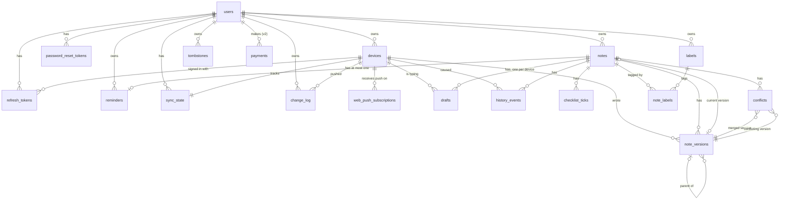

# Tracepad: database schema (proposal)

The database design behind every flow in `Tracepad-Full-Flow.md`. Nothing here is built yet. This is a proposal to review before the build starts.

- **Server:** PostgreSQL is the source of truth. Flyway runs the migrations.
- **Devices:** IndexedDB (through `idb`, then Dexie in v2) on the web and Room on Android keep a copy of the note tables, plus the outbox and the sync state.
- **IDs:** every row ID is a UUID made on the device, so notes created offline never clash and a retried push never creates a duplicate.
- **Owner:** the `users` table anchors everything. Every user-owned table has a `user_id` foreign key, directly or through its note.

Tables marked **v2** come from section 18 of the flow document.

---

## 1. Relationship map



| From                       | To                                      | Kind                                         |
| -------------------------- | --------------------------------------- | -------------------------------------------- |
| `users`                    | `devices`                               | One-to-many                                  |
| `users`                    | `notes`                                 | One-to-many                                  |
| `users`                    | `labels`                                | One-to-many                                  |
| `users`                    | `reminders`                             | One-to-many                                  |
| `users`                    | `sync_state`                            | One-to-many (one row per device)             |
| `users`                    | `refresh_tokens`                        | One-to-many                                  |
| `users`                    | `password_reset_tokens`                 | One-to-many                                  |
| `users`                    | `change_log`, `tombstones`              | One-to-many                                  |
| `users`                    | `payments` (v2)                         | One-to-many                                  |
| `devices`                  | `sync_state`                            | One-to-one                                   |
| `devices`                  | `refresh_tokens`                        | One-to-many                                  |
| `devices`                  | `web_push_subscriptions`                | One-to-many                                  |
| `notes`                    | `note_versions`                         | One-to-many                                  |
| `notes.current_version_id` | `note_versions`                         | Many-to-one (the note's current version)     |
| `note_versions`            | `note_versions` (`parent_version_id`)   | Self-reference: versions form a tree         |
| `notes`                    | `drafts`                                | One-to-many, at most one per device          |
| `notes`                    | `checklist_ticks`                       | One-to-many                                  |
| `notes`                    | `history_events`                        | One-to-many                                  |
| `notes`                    | `conflicts`                             | One-to-many                                  |
| `notes`                    | `reminders`                             | One-to-zero-or-one                           |
| `notes`                    | `labels`                                | Many-to-many through `note_labels`           |

---

## 2. Accounts and devices

### `users`

The anchor table. Account settings from v2 live here too, since each is a single value per account.

```sql
CREATE TABLE users (
  id                  uuid PRIMARY KEY,
  email               text NOT NULL,
  password_hash       text,                              -- BCrypt; empty for Google-only accounts (v2)
  google_sub          text UNIQUE,                       -- v2 Google sign-in
  email_verified_at   timestamptz,                       -- v2 email verification
  active_note_limit   smallint NOT NULL DEFAULT 12
                      CHECK (active_note_limit BETWEEN 1 AND 15),   -- v2
  auto_archive_after  interval,                          -- v2; empty = choose from how often you write
  review_frequency    text NOT NULL DEFAULT 'monthly'
                      CHECK (review_frequency IN ('monthly','quarterly','semiannual','annual')),  -- v2
  strict_mode         boolean NOT NULL DEFAULT false,    -- v2
  strict_snooze_secs  int NOT NULL DEFAULT 30,           -- v2
  review_streak       int NOT NULL DEFAULT 0,            -- v2
  last_review_at      timestamptz,                       -- v2
  paid_until          timestamptz,                       -- v2 payments
  created_at          timestamptz NOT NULL DEFAULT now(),
  deleted_at          timestamptz                        -- soft delete; the row stays
);
```

**Relationships:** the parent of `devices`, `refresh_tokens`, `password_reset_tokens`, `notes`, `labels`, `reminders`, `sync_state`, `change_log`, `tombstones` and `payments`.

### `devices`

One row per browser or phone that has signed in. It supplies the device name behind "Laptop is editing" and "Newer version from Phone."

```sql
CREATE TABLE devices (
  id            uuid PRIMARY KEY,                        -- made by the device
  user_id       uuid NOT NULL REFERENCES users(id),
  name          text NOT NULL,                           -- "Laptop", "Phone"
  platform      text NOT NULL CHECK (platform IN ('web','android')),
  created_at    timestamptz NOT NULL,
  last_seen_at  timestamptz
);
```

**Relationships:** belongs to one user. The parent of `sync_state` (one-to-one), `refresh_tokens` and `web_push_subscriptions`. Referenced by `note_versions`, `drafts`, `history_events` and `change_log` to record which device made a change.

### `refresh_tokens`

```sql
CREATE TABLE refresh_tokens (
  id          uuid PRIMARY KEY,
  user_id     uuid NOT NULL REFERENCES users(id),
  device_id   uuid NOT NULL REFERENCES devices(id) ON DELETE CASCADE,
  token_hash  text NOT NULL UNIQUE,
  expires_at  timestamptz NOT NULL,                      -- about 30 days
  revoked_at  timestamptz                                -- set on logout, password reset, account delete
);
```

**Relationships:** belongs to one user and one device.

### `password_reset_tokens`

```sql
CREATE TABLE password_reset_tokens (
  token_hash  text PRIMARY KEY,
  user_id     uuid NOT NULL REFERENCES users(id),
  expires_at  timestamptz NOT NULL,
  used_at     timestamptz
);
```

**Relationships:** belongs to one user.

---

## 3. Notes

### `notes`

The current state of each note. The text itself lives in `note_versions`.

```sql
CREATE TABLE notes (
  id                  uuid PRIMARY KEY,                  -- made by the device
  user_id             uuid NOT NULL REFERENCES users(id),
  current_version_id  uuid,                              -- FK added below
  is_pinned           boolean NOT NULL DEFAULT false,
  is_archived         boolean NOT NULL DEFAULT false,
  color               text,
  trashed_at          timestamptz,                       -- trash is a flag; pin and color are kept
  sort_position       double precision,                  -- v2 custom drag order
  created_at          timestamptz NOT NULL,
  updated_at          timestamptz NOT NULL,              -- the board sort
  server_updated_at   timestamptz NOT NULL               -- "later wins" uses server receive time
);
```

**Relationships:** belongs to one user. Points to its current version in `note_versions`. The parent of `note_versions`, `drafts`, `checklist_ticks`, `history_events`, `conflicts` and `reminders`. Linked many-to-many to `labels` through `note_labels`.

### `note_versions`

A version is never changed after it is written. Parent links form a tree, and that tree is how a conflict is detected.

```sql
CREATE TABLE note_versions (
  id                 uuid PRIMARY KEY,
  note_id            uuid NOT NULL REFERENCES notes(id) ON DELETE CASCADE,
  parent_version_id  uuid REFERENCES note_versions(id),  -- empty for the first version
  device_id          uuid NOT NULL REFERENCES devices(id),
  kind               text NOT NULL CHECK (kind IN ('text','checklist')),
  title              text,
  body               text,                               -- text notes
  checklist_items    jsonb,                              -- checklists: [{id, text, position}]
  created_at         timestamptz NOT NULL,               -- device time
  received_at        timestamptz NOT NULL                -- server time
);

ALTER TABLE notes
  ADD FOREIGN KEY (current_version_id) REFERENCES note_versions(id)
  DEFERRABLE INITIALLY DEFERRED;
```

**Relationships:** belongs to one note. Written by one device. Points to its parent version. Referenced by `notes.current_version_id`, `drafts.base_version_id` and the three version columns in `conflicts`.

### `checklist_ticks`

Ticks live on the note, not the version, so ticking cuts no version.

```sql
CREATE TABLE checklist_ticks (
  note_id     uuid NOT NULL REFERENCES notes(id) ON DELETE CASCADE,
  item_id     uuid NOT NULL,                             -- matches an id inside checklist_items
  ticked      boolean NOT NULL,
  updated_at  timestamptz NOT NULL,                      -- the later tick wins
  PRIMARY KEY (note_id, item_id)
);
```

**Relationships:** belongs to one note.

### `drafts`

Drafts sync too. Each device keeps its own draft of a note, so neither overwrites the other.

```sql
CREATE TABLE drafts (
  note_id          uuid NOT NULL REFERENCES notes(id) ON DELETE CASCADE,
  device_id        uuid NOT NULL REFERENCES devices(id) ON DELETE CASCADE,
  base_version_id  uuid REFERENCES note_versions(id),   -- the version that was opened
  kind             text NOT NULL CHECK (kind IN ('text','checklist')),
  title            text,
  body             text,
  checklist_items  jsonb,
  updated_at       timestamptz NOT NULL,
  PRIMARY KEY (note_id, device_id)
);
```

**Relationships:** belongs to one note and one device. Points to the version it started from.

### `conflicts`

```sql
CREATE TABLE conflicts (
  id                      uuid PRIMARY KEY,
  note_id                 uuid NOT NULL REFERENCES notes(id) ON DELETE CASCADE,
  merged_version_id       uuid NOT NULL REFERENCES note_versions(id),  -- the earlier edit, merged
  conflicting_version_id  uuid NOT NULL REFERENCES note_versions(id),  -- the later edit, badged
  detected_at             timestamptz NOT NULL,
  resolved_at             timestamptz,
  chosen_version_id       uuid REFERENCES note_versions(id)
);
```

**Relationships:** belongs to one note. Points to two versions, plus a third once you pick one.

### `history_events`

The small entries in the history timeline. Color changes are not recorded.

```sql
CREATE TABLE history_events (
  id           uuid PRIMARY KEY,
  note_id      uuid NOT NULL REFERENCES notes(id) ON DELETE CASCADE,
  device_id    uuid REFERENCES devices(id),              -- empty for server jobs (auto-archive)
  type         text NOT NULL CHECK (type IN (
                 'pinned','unpinned','label_added','label_removed',
                 'archived','unarchived','auto_archived','trashed','restored',
                 'ticked','unticked','reminder_set','reminder_changed','reminder_removed',
                 'conflict_resolved')),
  payload      jsonb,                                    -- e.g. {label_id}, {item_id}, {fire_at}
  occurred_at  timestamptz NOT NULL
);
```

**Relationships:** belongs to one note. Caused by one device, or by the server.

---

## 4. Labels

### `labels`

```sql
CREATE TABLE labels (
  id          uuid PRIMARY KEY,
  user_id     uuid NOT NULL REFERENCES users(id),
  name        text NOT NULL,
  updated_at  timestamptz NOT NULL                       -- the later rename wins
);
```

**Relationships:** belongs to one user. Linked many-to-many to `notes` through `note_labels`.

### `note_labels`

The join between notes and labels.

```sql
CREATE TABLE note_labels (
  note_id     uuid NOT NULL REFERENCES notes(id) ON DELETE CASCADE,
  label_id    uuid NOT NULL REFERENCES labels(id) ON DELETE CASCADE,
  is_removed  boolean NOT NULL DEFAULT false,            -- so an offline add or remove can be "later wins"
  updated_at  timestamptz NOT NULL,
  PRIMARY KEY (note_id, label_id)
);
```

**Relationships:** belongs to one note and one label.

---

## 5. Reminders

### `reminders`

One reminder per note, either one-time or repeating. The local alarm is primary and the server push is the backup.

```sql
CREATE TABLE reminders (
  note_id          uuid PRIMARY KEY REFERENCES notes(id) ON DELETE CASCADE,
  user_id          uuid NOT NULL REFERENCES users(id),
  fire_at          timestamptz NOT NULL,                 -- the next time it fires
  repeat_interval  interval,                             -- empty = one-time
  last_fired_at    timestamptz,                          -- for missed and late notices
  dismissed_at     timestamptz,                          -- tapping on one device clears the others
  push_sent_at     timestamptz,                          -- the backup push already went out
  updated_at       timestamptz NOT NULL
);
```

Paused while the note is in the trash. That comes from `notes.trashed_at`, so it isn't stored twice.

**Relationships:** belongs to one user and to one note (at most one reminder per note).

### `web_push_subscriptions`

Where the server sends the backup push for a browser.

```sql
CREATE TABLE web_push_subscriptions (
  id          uuid PRIMARY KEY,
  device_id   uuid NOT NULL REFERENCES devices(id) ON DELETE CASCADE,
  endpoint    text NOT NULL UNIQUE,
  p256dh      text NOT NULL,
  auth        text NOT NULL,
  created_at  timestamptz NOT NULL
);
```

**Relationships:** belongs to one device, and through it to one user.

---

## 6. Sync

### `change_log`

Every accepted change, numbered by the server. The pull bookmark is a position in this table.

```sql
CREATE TABLE change_log (
  seq          bigserial PRIMARY KEY,                    -- server numbering
  row_id       uuid NOT NULL UNIQUE,                     -- the outbox row ID; duplicate pushes are ignored
  user_id      uuid NOT NULL REFERENCES users(id),
  device_id    uuid NOT NULL REFERENCES devices(id),
  entity_type  text NOT NULL CHECK (entity_type IN (
                 'note','version','draft','tick','conflict','history',
                 'label','note_label','reminder')),
  entity_id    uuid NOT NULL,
  op           text NOT NULL CHECK (op IN ('create','update','delete','purge')),
  payload      jsonb NOT NULL,
  client_at    timestamptz NOT NULL,
  received_at  timestamptz NOT NULL DEFAULT now()
);
```

**Relationships:** belongs to one user. Pushed by one device. `entity_type` and `entity_id` point to a row in one of the tables above. It's a loose reference rather than a foreign key, because the row may already be gone.

### `sync_state`

How far each of a user's devices has synced. The server uses it to answer "bookmark too old" with a full download.

```sql
CREATE TABLE sync_state (
  device_id        uuid PRIMARY KEY REFERENCES devices(id) ON DELETE CASCADE,
  user_id          uuid NOT NULL REFERENCES users(id),
  last_pulled_seq  bigint NOT NULL DEFAULT 0,            -- the device's bookmark
  last_push_at     timestamptz,
  last_pull_at     timestamptz
);
```

**Relationships:** belongs to one user. One-to-one with a device.

### `tombstones`

Notes deleted forever. Kept 60 days so offline devices remove them on their next pull.

```sql
CREATE TABLE tombstones (
  entity_id   uuid PRIMARY KEY,                          -- the deleted note's ID
  user_id     uuid NOT NULL REFERENCES users(id),
  seq         bigint NOT NULL REFERENCES change_log(seq),
  deleted_at  timestamptz NOT NULL
);
```

**Relationships:** belongs to one user. Points to the `change_log` row that recorded the deletion.

---

## 7. Payments (v2)

### `payments`

Each M-Pesa payment: the KSh 20 monthly plan and Support Tracepad payments. `users.paid_until` is what the app checks; this table is the record.

```sql
CREATE TABLE payments (
  id                   uuid PRIMARY KEY,
  user_id              uuid NOT NULL REFERENCES users(id),
  kind                 text NOT NULL CHECK (kind IN ('subscription','support')),
  amount_kes           int NOT NULL,                     -- 20 for the monthly plan
  phone                text NOT NULL,
  checkout_request_id  text UNIQUE,                      -- Daraja STK Push
  mpesa_receipt        text UNIQUE,
  status               text NOT NULL CHECK (status IN ('pending','paid','failed','cancelled')),
  result_code          int,
  created_at           timestamptz NOT NULL,
  confirmed_at         timestamptz
);
```

**Relationships:** belongs to one user.

---

## 8. Device-only tables

These live only in IndexedDB on the web and Room on Android, beside copies of `notes`, `note_versions`, `checklist_ticks`, `drafts`, `conflicts`, `history_events`, `labels`, `note_labels` and `reminders`.

### `outbox`

```text
id           uuid       becomes change_log.row_id on the server
user_id      uuid       empty while signed out; filled in at first sign-in
entity_type  text       same values as change_log
entity_id    uuid
op           text       create | update | delete | purge
payload      json
created_at   timestamp
status       text       pending | sent
attempts     int
last_error   text
index: status + created_at
```

**Relationships:** belongs to one user once signed in. Each row becomes one `change_log` row on the server.

### `local_sync_state`

```text
key/value:
device_id     this device's ID
user_id       the signed-in user; empty while signed out
bookmark      last change_log.seq pulled
last_sync_at
```

**Relationships:** one per device. Belongs to the signed-in user, and mirrors that device's `sync_state` row on the server.

---

## 9. Indexes

```sql
-- Accounts
CREATE UNIQUE INDEX users_email_uq      ON users (lower(email)) WHERE deleted_at IS NULL;
CREATE INDEX devices_user_idx           ON devices (user_id);
CREATE INDEX refresh_tokens_user_idx    ON refresh_tokens (user_id) WHERE revoked_at IS NULL;

-- Board, archive view, trash view, sorting
CREATE INDEX notes_board_idx    ON notes (user_id, is_pinned DESC, updated_at DESC)
  WHERE trashed_at IS NULL AND is_archived = false;
CREATE INDEX notes_created_idx  ON notes (user_id, created_at DESC);
CREATE INDEX notes_archive_idx  ON notes (user_id, updated_at DESC)
  WHERE is_archived AND trashed_at IS NULL;
CREATE INDEX notes_trash_idx    ON notes (trashed_at) WHERE trashed_at IS NOT NULL;   -- 30-day purge

-- History and conflicts
CREATE INDEX note_versions_note_idx   ON note_versions (note_id, created_at DESC);
CREATE INDEX history_events_note_idx  ON history_events (note_id, occurred_at DESC);
CREATE INDEX conflicts_open_idx       ON conflicts (note_id) WHERE resolved_at IS NULL;
CREATE INDEX drafts_device_idx        ON drafts (device_id);

-- Labels
CREATE UNIQUE INDEX labels_name_uq  ON labels (user_id, lower(name));
CREATE INDEX note_labels_label_idx  ON note_labels (label_id) WHERE NOT is_removed;

-- Reminders
CREATE INDEX reminders_user_idx  ON reminders (user_id);
CREATE INDEX reminders_due_idx   ON reminders (fire_at)
  WHERE dismissed_at IS NULL AND push_sent_at IS NULL;                               -- backup-push job

-- Sync
CREATE INDEX change_log_pull_idx    ON change_log (user_id, seq);
CREATE INDEX change_log_entity_idx  ON change_log (user_id, entity_type, entity_id);
CREATE INDEX sync_state_user_idx    ON sync_state (user_id);
CREATE INDEX tombstones_age_idx     ON tombstones (deleted_at);                     -- 60-day cleanup

-- Payments (v2)
CREATE INDEX payments_user_idx  ON payments (user_id, created_at DESC);
```

Search has no index. On the web it scans the current versions in JavaScript, and on Android it uses SQL `LIKE`.

---

## 10. Design notes

- **Text and everything else:** text lives in `note_versions`, and a version is never changed. Pin, archive, color, labels, ticks and reminders live on their own rows with an `updated_at`. That is why they cut no version, never conflict, and follow "the later change wins."
- **Pulling:** a device downloads `change_log` rows after its bookmark. A row the bookmark has already passed is still applied if its `received_at` is newer than what the device holds. The bookmark still moves forward.
- **Guest notes:** while signed out, device rows and outbox rows have no user. At first sign-in they get the new `user_id`, and the outbox uploads.
- **Deleting an account:** sets `users.deleted_at` and revokes every refresh token. No rows are removed.
- **Deleting a note forever:** removes the note row (the cascade takes its versions, drafts, ticks, history, conflicts, label links and reminder) and writes a `change_log` row and a tombstone.
