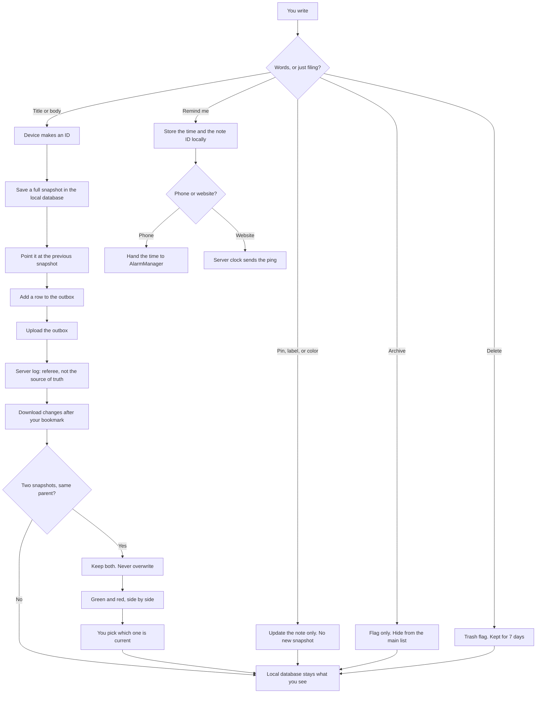
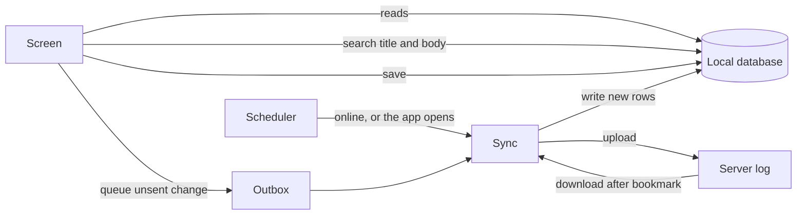

# How a Tracepad note moves

Plain map of the lifecycle. Each device shows what is in its own database. The server keeps a log of changes and passes them on. It does not decide which version you are looking at.

## The whole path

Creating a note is the words path with no previous snapshot. Editing is the same path, and the new snapshot names its parent. Search never leaves the device: it looks through title and body with a `LIKE` query. Those two columns are indexed.

## One device, close up

The screen never waits on the server. A save lands in the local database and in the outbox together. Sync runs later, sends the outbox, and brings back other devices' rows.
